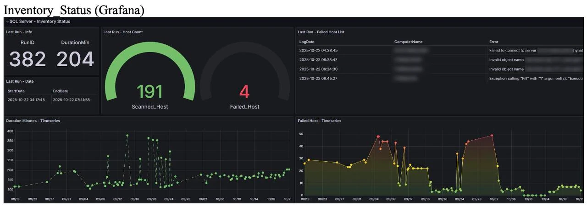
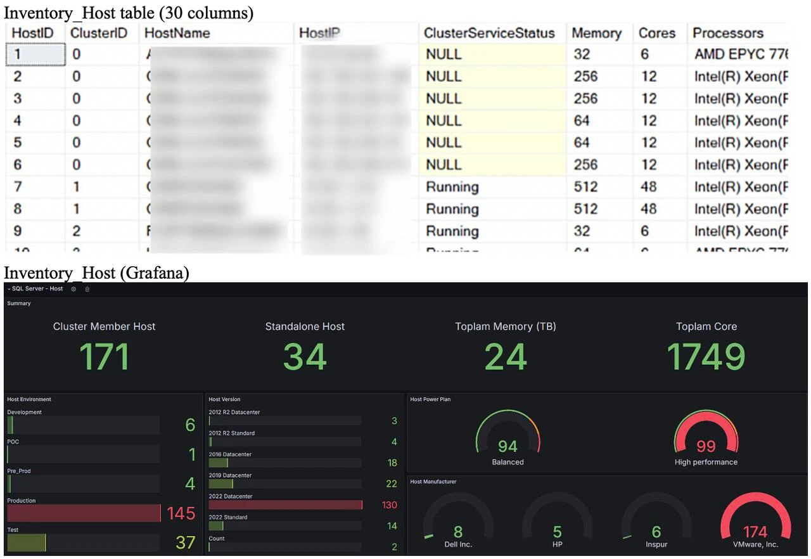
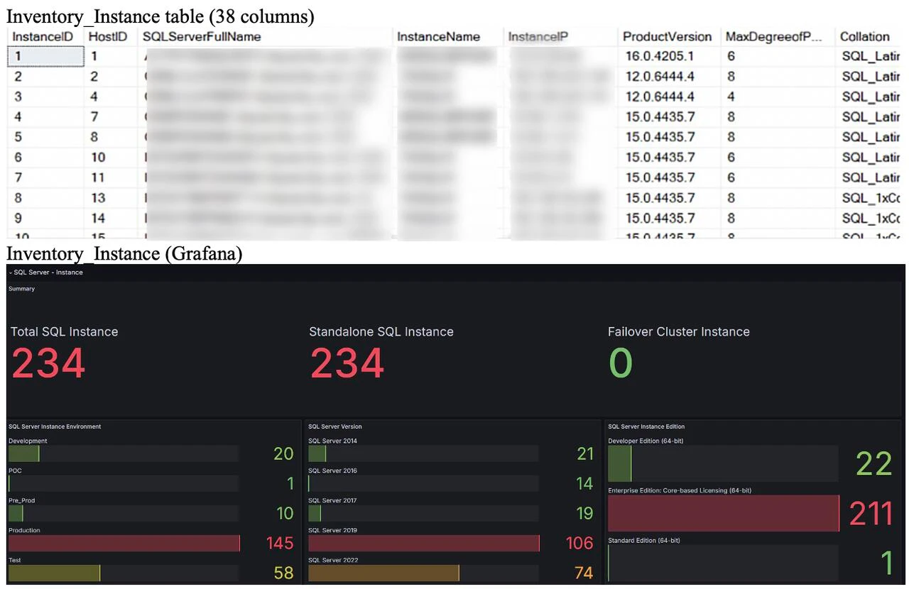
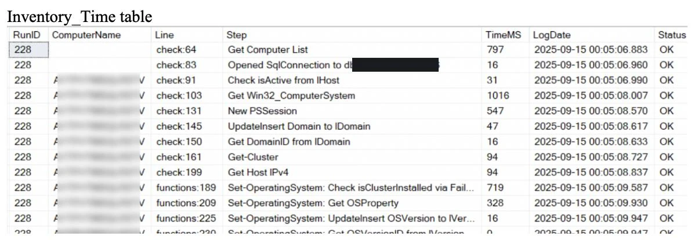
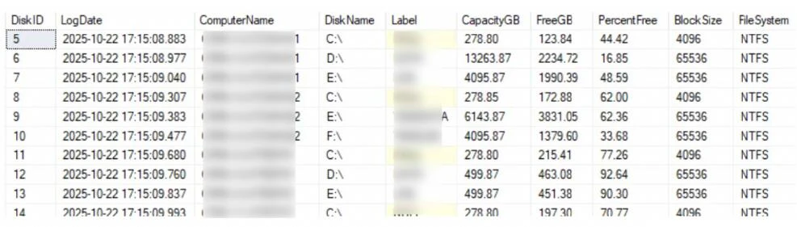
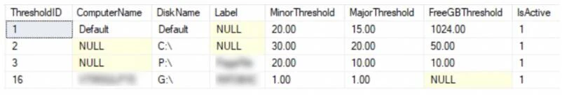
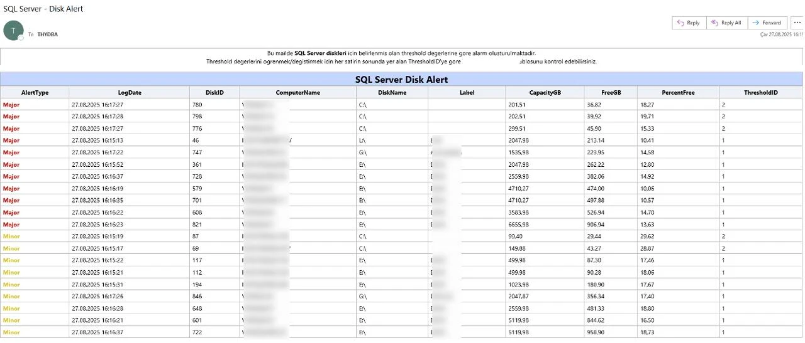
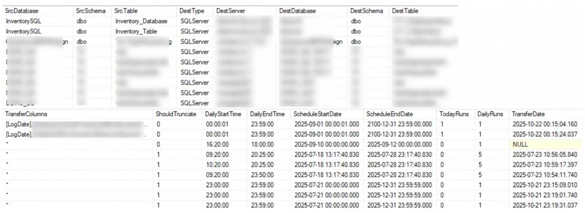
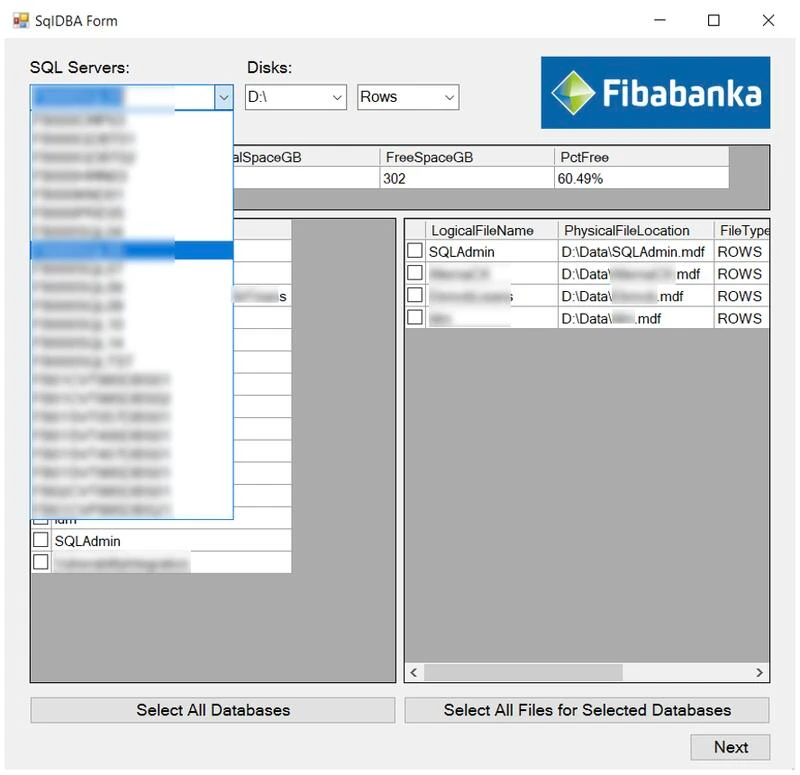
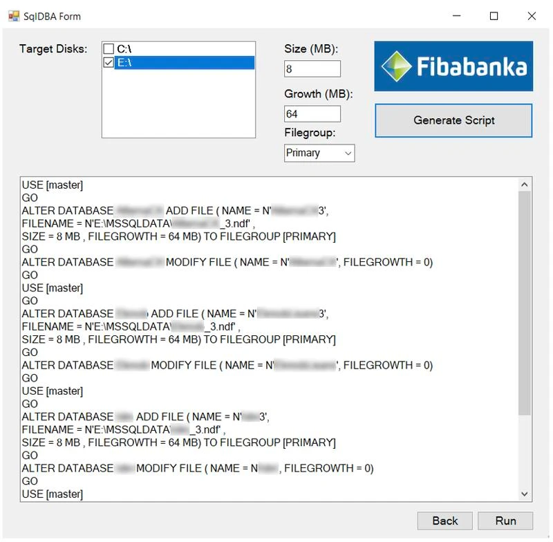

##  Dynamic Inventory

Built a PowerShell-based CMDB system that runs daily (covering 190+ Windows hosts in about 2 hours). It collects and centralize: host/OS (FQDN, power plan, CPU cores, memory, OS version/edition/build), clustering (is-clustered, cluster name), SQL instances (version/edition, engine level, port, service account), availability groups (AG name, listener DNS/IP), databases (status, size MB for data/log, recovery model, collation, compatibility level, create date), and tables (row count, reserved/data/index/unused MB). Data is bulk-loaded into a central SQL schema and upserted with set-based MERGEs, with per-step timing (RunID) and error logging. Integrated the central inventory DB with Grafana to deliver live dashboards.

##  Backup Compliance Monitoring

Built a Powershell-based system that dynamically adapts to the company’s evolving backup strategy, including Full, Diff, and T-Log schedules. The system automatically determines the expected backup frequency for each type, detects databases that exceed their allowed time thresholds, and sends automated alert emails to responsible teams.

##  Disk Usage Monitoring

Built a Powershell-based system for SQL Server, enhanced with customizable per-disk thresholds and Minor/Major alert levels to improve flexibility, risk assessment, and prioritization.

##  Cross-Database Transfer

Developed a Powershell tool for automated data transfers across diverse database systems, including SQL Server, Oracle, and PostgreSQL. Enabled users to select columns, configure transfer frequency, and define date/time ranges for scheduled transfers.

##  SQL File Transfer

Developed an application in PowerShell to simplify transferring user-selected files between SQL Server disks and target disks. Designed a responsive GUI and enabled users to generate a single SQL query that handled the entire transfer and execute it directly.

