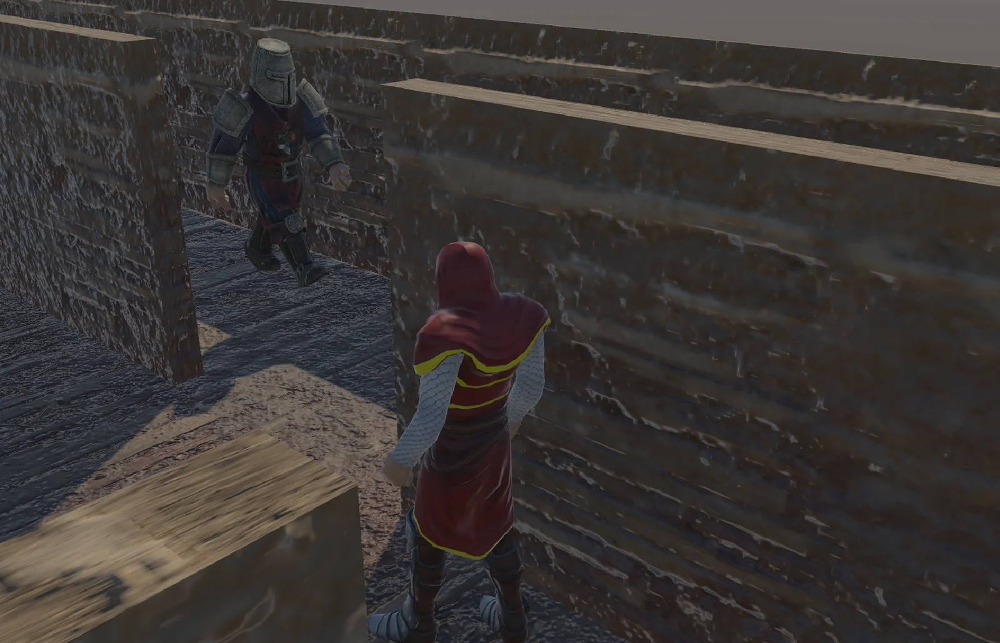
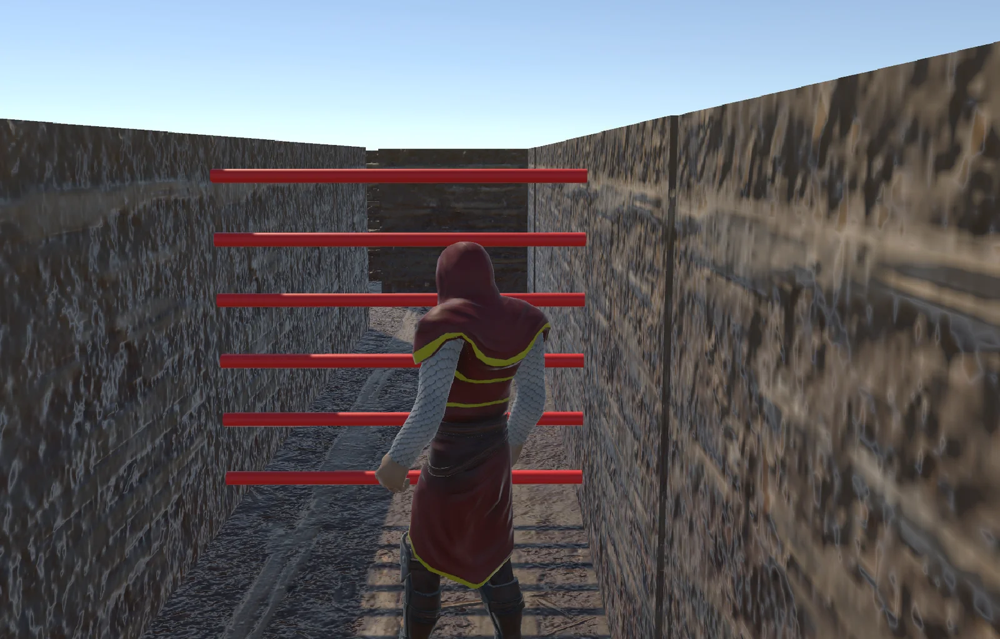
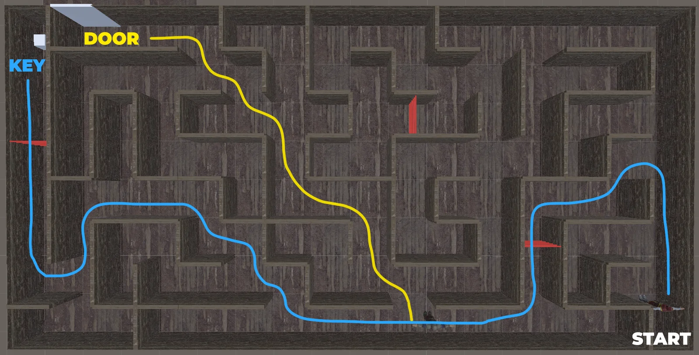

## Overview

A third-person 3D maze game developed in Unity. The objective is to navigate the maze, avoid traps, push a physics-based key to the exit door, and escape.

Watch the <a href="https://youtu.be/JgVkeFkvQ3A" target="_blank" rel="noopener noreferrer">gameplay video</a>.

## Maze Map

The key starts at one corner of the maze and has to be pushed all the way to the door.

## Game Objects

- **Key (Cube):** A standard cube with a Rigidbody and gravity enabled. It is affected by physics and forces applied by the player character.
- **Door:** A specific wall segment blocking the exit path. It acts as a trigger for the end-game sequence.
- **Lasers:** Red cylinder obstacles that blink on and off every 2 seconds. When active, they act as deadly triggers.
- **Castle Guard:** An AI entity that constantly patrols back and forth between two fixed points along a straight path.

## Conditions

- **Win:** The player must physically push the key through the maze until it collides with the door. This collision triggers the "You Win" screen.
- **Lose:** If the player touches an active laser or the patrolling guard, the player dies instantly. This triggers the "Game Over" screen.

## Controls

| Key | Action |
| --- | --- |
| W, A, S, D | Move the player |
| Shift | Sprint |
| Mouse | Control the camera direction |
| M | Toggle background music |

## Assets Used

- <a href="https://assetstore.unity.com/packages/essentials/starter-assets-thirdperson-urp-196526" target="_blank" rel="noopener noreferrer">Third Person Character Controller</a> for the player and guard controllers and animations.
- <a href="https://assetstore.unity.com/packages/3d/environments/dungeons/tileable-maze-and-dungeon-blocks-259878" target="_blank" rel="noopener noreferrer">Tileable Maze and Dungeon Blocks</a> for the maze floor and wall prefabs.
- <a href="https://www.mixamo.com" target="_blank" rel="noopener noreferrer">Mixamo</a> models: Knight D Pellegrini as the player, configured to push Rigidbody objects, and Castle Guard as the patrolling enemy.
