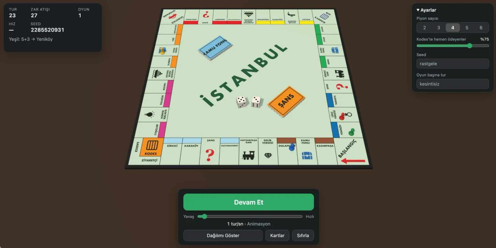
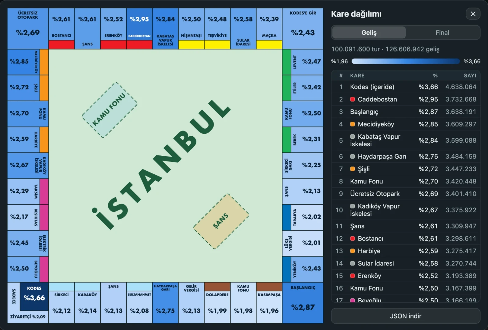
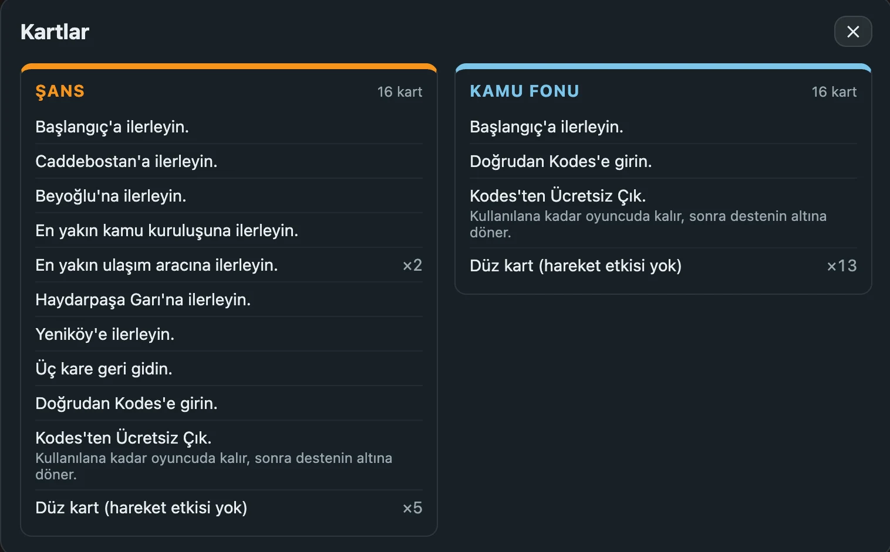

## Overview

How often does a pawn land on each square of Monopoly? This project is a seeded Monte Carlo engine that plays the İstanbul edition turn by turn, with a 3D board to watch it happen and a heatmap of where the pawns end up.

- **Every movement rule.** Doubles and re-rolls, jail on three doubles, Go to Jail, the ways out of jail, and real Chance and Community Chest decks.
- **Watch or crunch.** From half a turn per second with animated dice and hopping pawns, up to a million turns per second in turbo mode.
- **Reproducible.** The same seed gives the same numbers in the browser and on the command line.
- **No server.** Everything runs in the browser; the site is plain static files.

## Results: 100 Million Turns

If every square were equally likely, each would get about 2.4% of the landings. After 100,091,600 turns, they don't:

- **Jail is the busiest place on the board** (3.66%): Go to Jail, three doubles, and the jail cards all send pawns there.
- **Next come squares a couple of rolls past Jail, and card targets.** Caddebostan (2.95%) is the most visited property, followed by Başlangıç (2.87%), Mecidiyeköy (2.85%), and Kabataş Vapur İskelesi (2.84%). Pawns leaving Jail pass this stretch often, and cards send pawns straight to Caddebostan, Başlangıç, and the nearest station.
- **The first side is the quietest.** Kasımpaşa (1.96%), the first Kamu Fonu (1.98%), and Dolapdere (1.99%) are the least visited squares on the board.

## The Cards Are Part of the Simulation

Cards are not modeled as fixed probabilities: each game shuffles both 16-card decks, cards are drawn from the top and go back to the bottom, and a "Get Out of Jail Free" card stays with the player until it is used. 10 of the 16 Chance cards move the pawn; in Community Chest, only 2 do.

## Scope

The simulation only rolls dice and moves: there is no property, rent, money, or houses and hotels. Every rule that affects movement is implemented, including the rules for getting out of jail. On each jail entry, a player either pays right away or tries to roll a double, and the share of players who pay is a setting.

The engine has no runtime dependencies and also runs from the command line, writing its results as JSON. Three.js is used only by the 3D visualization.

## Speed Regimes

| Regime | Speed | What you see |
| --- | --- | --- |
| Animated | ≤ 10 turns/s | The dice roll, the pawn hops square by square, and the drawn card is shown. |
| Quick | 10–60 turns/s | The dice values appear directly; the pawn slides to the square where the turn ends. |
| Turbo | > 60 turns/s | No animation; pawns jump to their current position every frame. |

## Data Sources

The board is the classic Monopoly İstanbul edition with neighborhood names, based on public listings of the edition and Hasbro's 2010 Turkish rulebook. The exact text of the Turkish cards could not be found online, so the movement cards are the İstanbul-board equivalents of Hasbro's international standard set.

Everything on the board is drawn in code; no Hasbro logos, mascots, or artwork are used. Monopoly is a trademark of Hasbro; this is an independent project, not affiliated with or endorsed by Hasbro.
