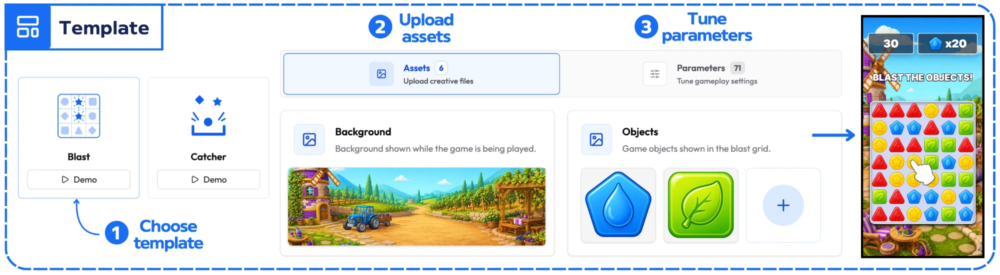
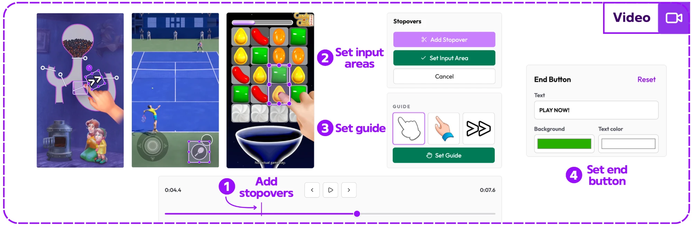
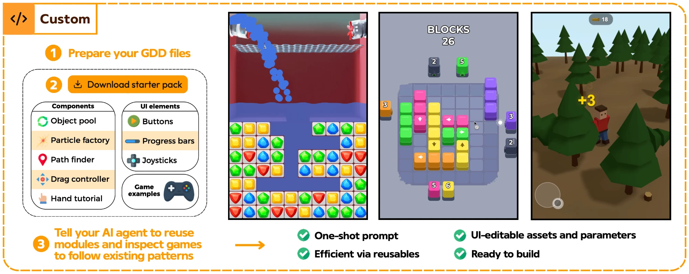
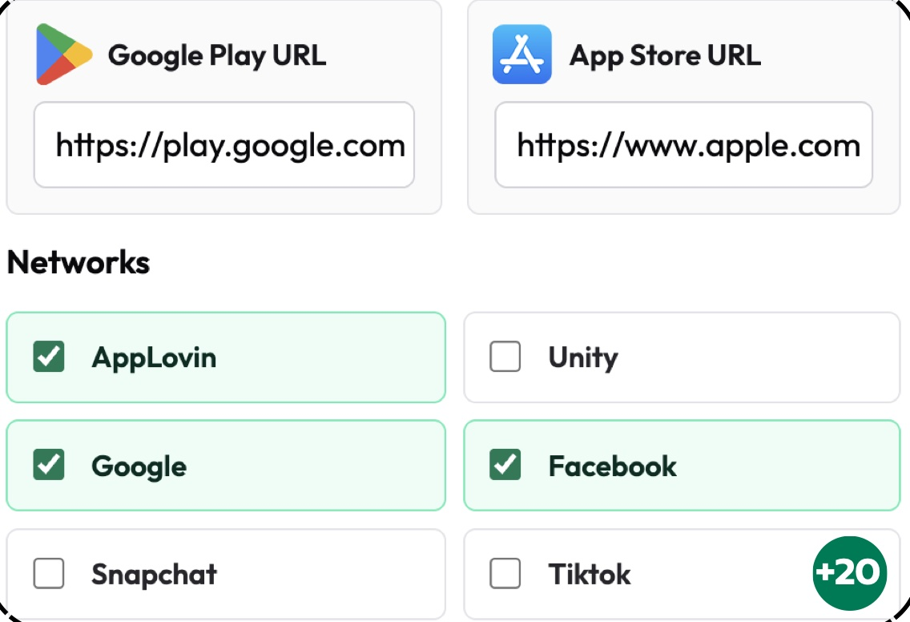

## Introduction

Mobile apps and games are full of ads that many users skip or ignore. Playables stand out by turning the ad into a hands-on experience: instead of just watching, users interact with a short demo that immediately communicates the core value of the product.

Playable development may look simple, but strict limits such as the 5 MB size cap and the different requirements of each ad network make it challenging. To simplify this, we built a local workspace that speeds up both production and builds.

## Creation Flow

### Template

Ready templates for frequently used formats.

### Video

Converts gameplay videos into playables.

### Custom

Unique concepts are developed by AI agents using a starter pack that contains reusable modules and example games.

## Build

After the creation phase, users can view and test their playables, and manage the entire build process for 20+ ad networks directly inside the app. Builds are generated automatically according to each selected network's requirements.

## Results

Playable Lab is useful for teams that want to quickly create playables by replacing assets in ready templates, or that already have gameplay videos prepared for social media channels. For Custom mode, defining reusable modules and exposing them to AI agents improved quality and reduced manual effort.

Overall, Playable Lab shortens development time and improves consistency:

| Playable type | AI-assisted development | With Playable Lab |
| --- | --- | --- |
| Template | ~3 hours | 10 mins |
| Video | ~2 hours | 10 mins |
| Custom | ~10 hours | ~1 hour |

## Team

Built by Batuhan Büber and <a href="https://www.linkedin.com/in/muhammet-berkay-keskin-a9b0b321b/" target="_blank" rel="noopener noreferrer">Berkay Keskin</a> at Boğaziçi University, advised by <a href="https://www.linkedin.com/in/atay-ozgovde-28371448/" target="_blank" rel="noopener noreferrer">Atay Özgövde</a> and <a href="https://www.linkedin.com/in/bilal-at%C4%B1m-628066191/" target="_blank" rel="noopener noreferrer">Bilal Atım</a>.
