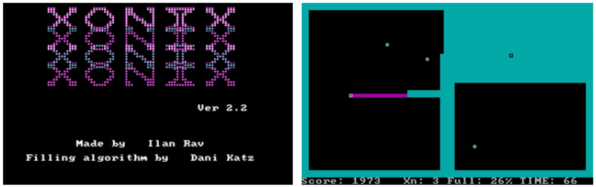
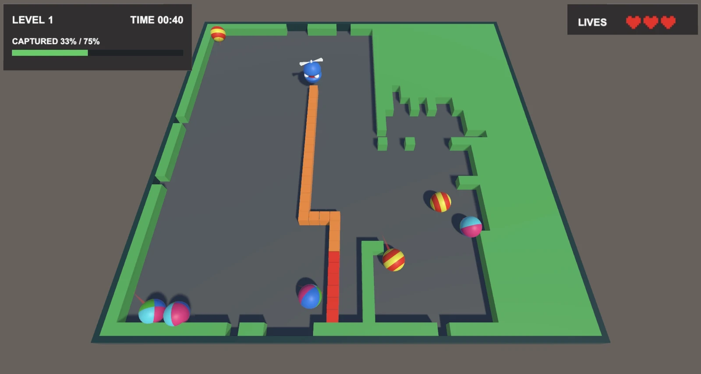
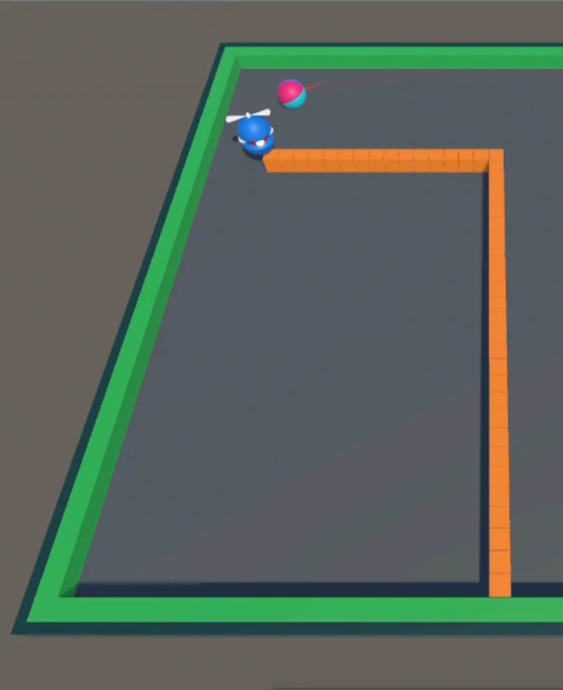
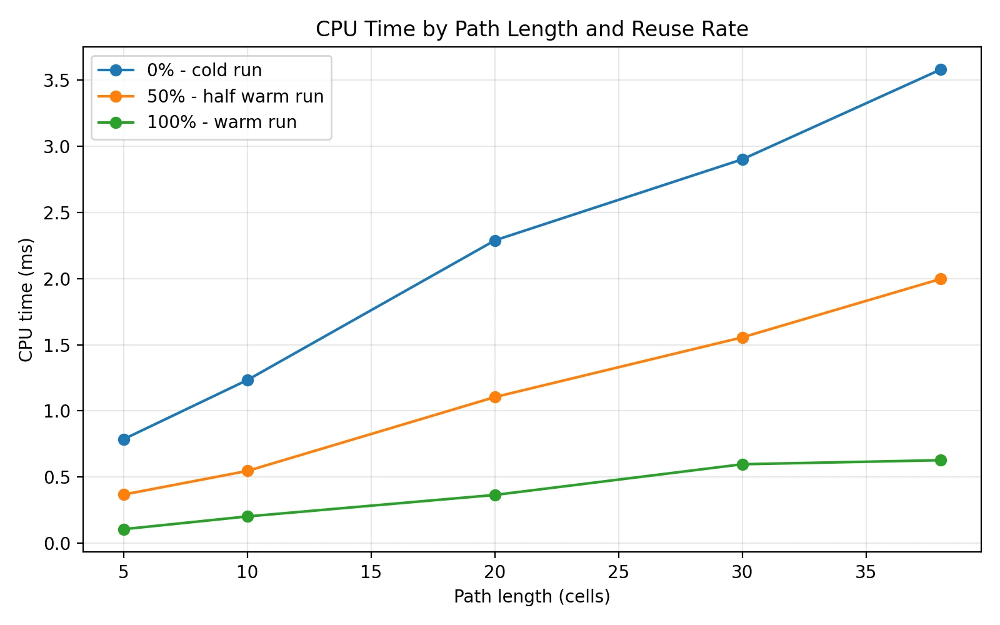
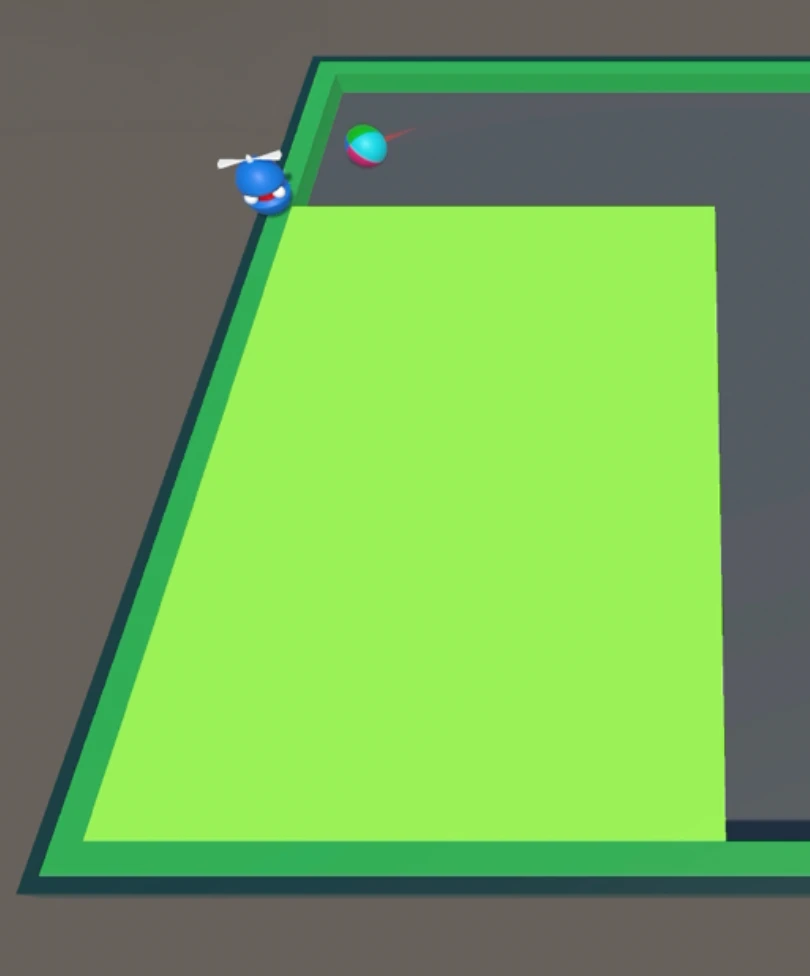
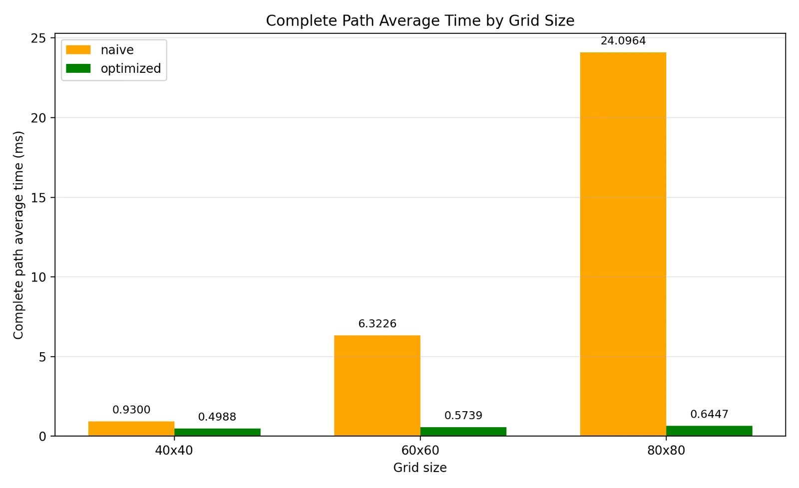
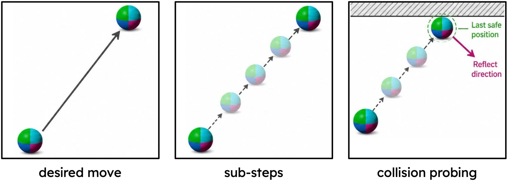
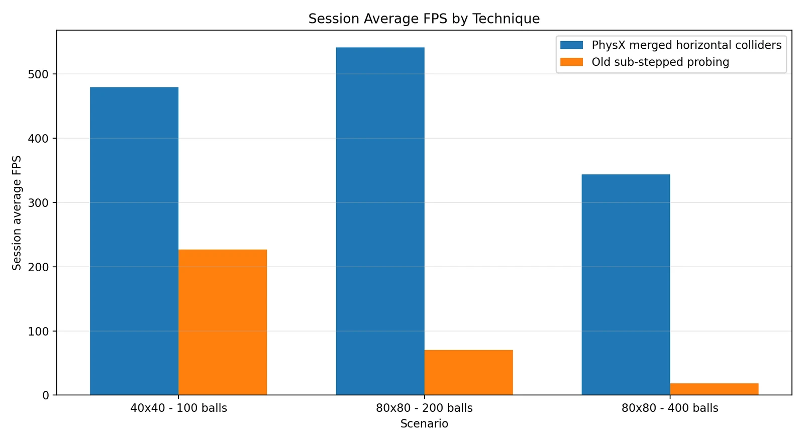
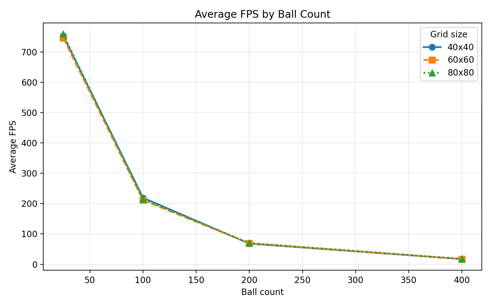

## Motivation

Xonix is one of the well-known classic games, released in 1984. Its graphics are not fancy, but the gameplay is very fun and competitive.

I really enjoyed playing Xonix, so I wanted to make a modern 3D version of it. My goal was to keep the main gameplay idea of Xonix and present it in a 3D environment.

## Design

Xonix3D is a level-based game. In each level, the player tries to capture enough area to pass the level without touching the balls.

The progress bar, remaining time, and lives are shown at the top of the screen. The progress bar shows how much area is captured, the remaining time shows how much time is left for the level, and the lives show how many more chances the player has.

There are two types of balls. The first type only rolls inside the empty area. The second type can also eat the captured areas, which makes the game harder because the player can lose some of the captured area.

When a ball hits the player, the player dies. When a ball hits the temporary path, the path starts to burn. If the burning path reaches the player before the path is completed, the player loses one life.

## Technical Challenges

### Path Tiles

When the player creates a path, orange tiles appear on the grid to show the temporary path.

At first, I created and destroyed these tiles every time. Creating many objects during gameplay increases CPU usage and causes performance spikes.

The solution was object pooling. Instead of destroying a tile, I keep it in a pool and take one from there when a new path tile is needed. This reduces the number of new object creations during gameplay.

As the path gets longer, the difference between the cold run and the warm run also gets bigger. There is about an 82% decrease in CPU time.

### Area Capture

When the player completes a path, that area becomes captured and is shown with different tiles on the grid.

Rendering each cell one by one causes a performance drop, because a large captured area can contain many cells. In the optimized version, the captured cell states and visuals are updated all at once with a bulk grid update, which reduces the total work during area capture.

The difference between the naive and the optimized solution grows with the grid size:

### Ball Movement

At first, I did not use Unity physics for the balls. The game is grid-based, and I thought that using thousands of grid colliders would be expensive.

To handle ball movement without physics, I divided the movement into smaller steps to avoid tunneling and missed collisions. When a collision was detected, the system moved the ball back to its last safe position and reflected its direction.

Later, I tried Unity PhysX after <a href="https://www.linkedin.com/in/atay-ozgovde-28371448/" target="_blank" rel="noopener noreferrer">Atay Özgövde</a> suggested it. I expected it to cause performance problems, but the result was surprising: the pure physics version was faster than my custom movement system and also made ball collisions more realistic.

I then made one more improvement. Instead of using one collider for each blocked cell, horizontal blocked cells are merged into larger BoxColliders, so the balls collide with fewer and larger static colliders. This gave the best performance result.

PhysX is fast here because it has optimized systems for collision detection and contact solving, built on native C++ data structures. Even though real physics sounds heavier, it can be faster than repeated collision checks written in C#. The new BallController also does less custom work: it sets and keeps the velocity, handles gameplay effects, and lets PhysX choose the bounce direction.

## Performance Evaluation

To measure performance, I used grid size and ball count as parameters. Since I do not expect to use more than 100 balls in a level, the performance is good enough: in this range, the FPS stays above 200.

The results also show that grid size does not affect FPS much, while ball count has a big effect.

## Demo

Watch the <a href="https://drive.google.com/file/d/10KJ6QylwWiX28Uqw4KdwIAQzAlY7As2z/view?usp=share_link" target="_blank" rel="noopener noreferrer">30-second gameplay demo</a>.

## Conclusion

During development, I learned how to use the Profiler in a real game project. I could see which parts of the game were expensive and test my ideas with real data, which helped me understand the effect of optimization much better.

I also saw that the first solution is not always the best one. I first handled ball movement with my own code, then switched to Unity PhysX and got better results. Testing different approaches is very important in game development.

In the end, I took a classic game that I enjoy and built a 3D version of it with my own design and implementation.

Developed as a term project for CmpE 485 at Boğaziçi University.
